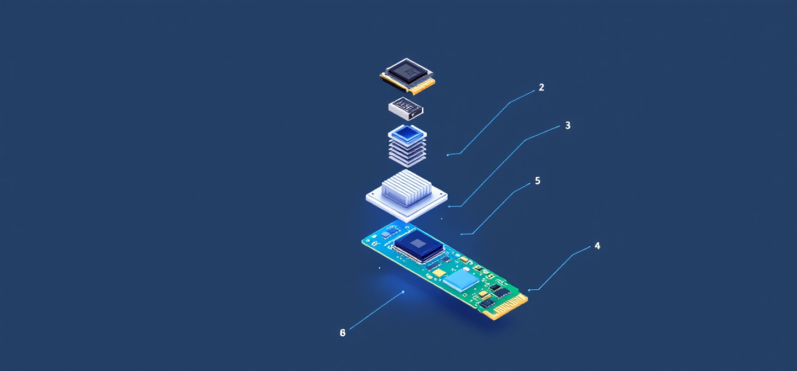
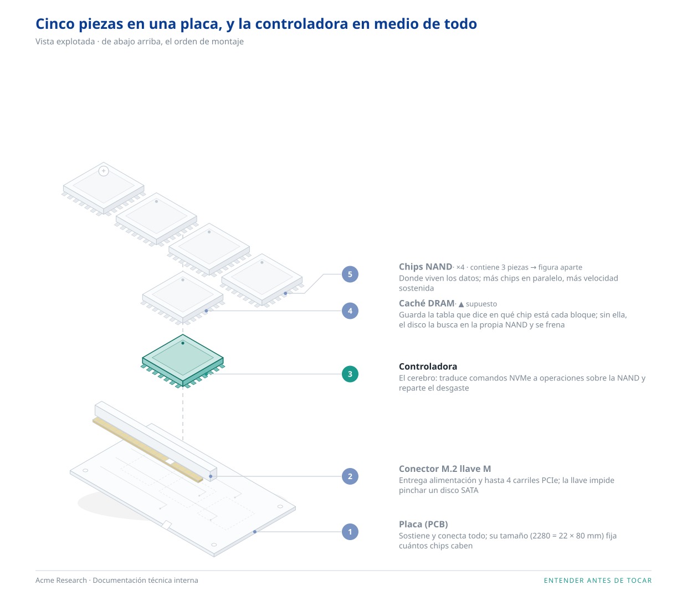
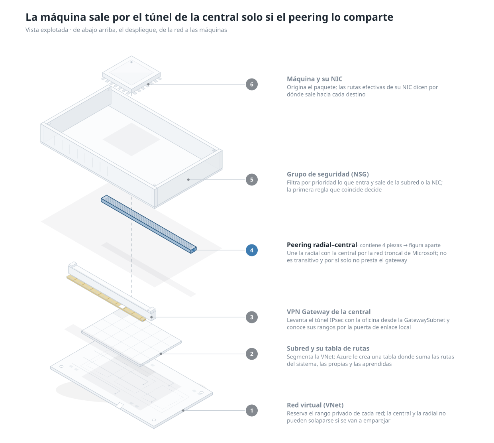
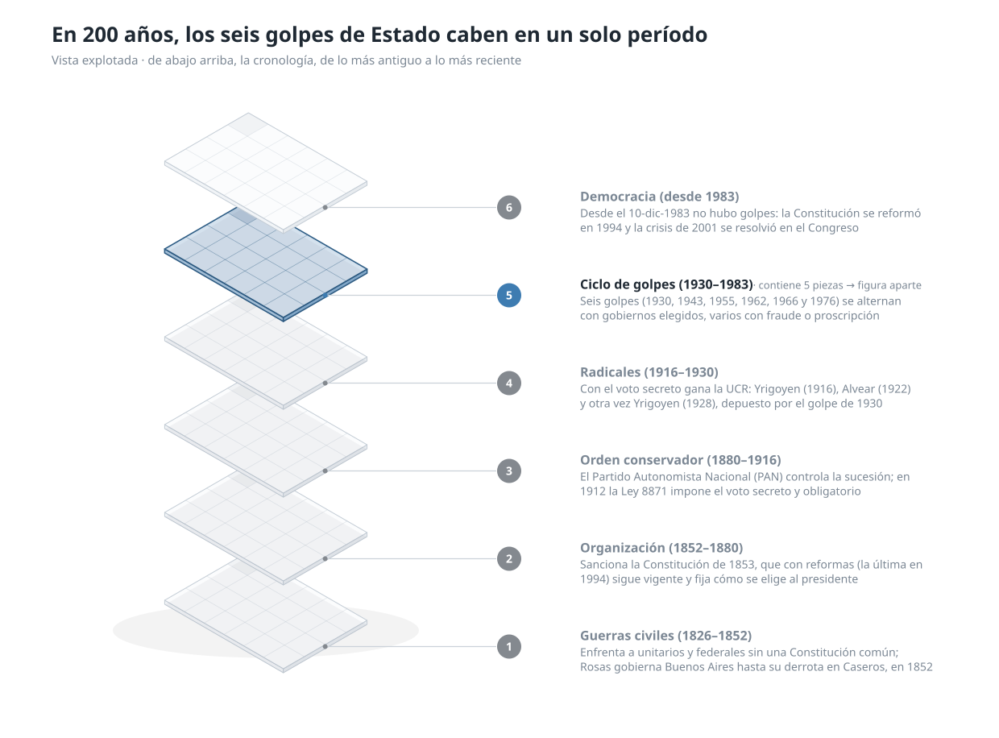
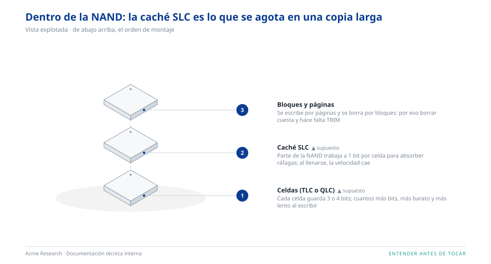

<div align="center">



# despiece

**Una skill de Claude Code que desarma cualquier cosa por niveles y te la explica con figuras.**

Un aparato, una red, una historia, una auditoría o una idea: `/despiece` lo abre capa por capa,
dibuja cada nivel y te hace tres preguntas para comprobar que lo entendiste de verdad.

[](SKILL.md)
[](scripts/)
[](LICENSE)
[](https://t28.io)

</div>

---

## ¿Qué hace?

Le pedís `/despiece SSD NVMe` (o `la red de la oficina en Azure`, `la historia argentina`, `una auditoría ISO 27001`) y la skill:

1. **Arma un modelo** en JSON con dos ejes y nada más: qué tiene que existir antes de qué (`orden`) y qué está dentro de qué (`padre`). Cada pieza lleva su función y la fuente de cada dato. Lo valida antes de dibujar nada.
2. **Dibuja cada nivel** como una **vista explotada isométrica**, sea un aparato, una red o una historia: las piezas separadas sobre un solo eje, de abajo arriba, con llamadas numeradas. Lo que ordena el eje lo dice el modelo: el montaje, el despliegue, la cronología, la profundidad.
3. **Ensambla una página HTML** (modo claro y oscuro) que se lee de arriba abajo: nivel 0 → nivel 1 → nivel 2…
4. **Te pone a prueba**: tres frases al estilo Feynman y una predicción. Si no las podés contestar, todavía no lo entendiste.

Con `--interactivo`, el mismo modelo sale como una página que **se abre y se recorre con el scroll**: se arma al
cargar, se desmonta pieza a pieza, sigue el flujo paso a paso y te deja entrar en la pieza que decide.
[Mirá la demo interactiva](docs/interactivo.md).

Con `--explorador`, cualquier modelo sale como un **explorador con zoom**: te acercás a una pieza con «+» y se abre
en su propia lámina; te alejás y volvés. Sirve para un SSD y para la historia de un país.
[Mirá la demo del explorador](docs/explorador.md).

> Sin dependencias: Python 3.10 o superior y nada más. La figura sale con `viewBox`, así que escala donde la pongas.
> Node 22 solo hace falta para capturar la interactiva o el explorador, y es opcional.

<table>
  <tr>
    <td width="33%" align="center"><a href="docs/demo/iso/n1-explosion.svg"></a></td>
    <td width="33%" align="center"><a href="docs/demo/ejemplos/red-nube-n1-explosion.svg"></a></td>
    <td width="33%" align="center"><a href="docs/demo/ejemplos/historia-argentina-n1-explosion.svg"></a></td>
  </tr>
  <tr>
    <td align="center"><sub><b>Un aparato</b> · el orden es el montaje</sub></td>
    <td align="center"><sub><b>Una red</b> · el orden es el despliegue</sub></td>
    <td align="center"><sub><b>Una historia</b> · el orden es la cronología</sub></td>
  </tr>
</table>

<p align="center"><sub>La misma figura para los tres: cambia el vocabulario, no la skill. Pieza con «+» = tiene su propia figura.<br>
<a href="docs/ejemplos.md"><b>Ver los 9 ejemplos con todos sus niveles</b></a>: un árbol genealógico, una auditoría ISO 27001, un pipeline de CI/CD, el subsuelo de Marte, el sentido del tacto…</sub></p>

---

<details>
<summary><b>🚀 Instalación en 30 segundos</b></summary>

<br>

Cloná el repo dentro de tu carpeta de skills de Claude Code:

```bash
# skills personales (todas tus sesiones)
git clone https://github.com/javierledesma28/skill-despiece ~/.claude/skills/despiece

# o solo para un proyecto
git clone https://github.com/javierledesma28/skill-despiece .claude/skills/despiece
```

Abrí Claude Code y probá:

```
/despiece SSD NVMe
```

Los scripts corren con Python 3.10 o superior, sin instalar paquetes. Si querés usarlos sueltos:

```bash
python -I scripts/validar_modelo.py assets/ejemplo-fisico.json
python -I scripts/explosionado.py assets/ejemplo-fisico.json --salida figuras/n1.svg --destacar controladora
python -I scripts/ensamblar.py assets/ejemplo-fisico.json --figuras figuras/ --salida despiece.html
python -I scripts/ensamblar.py assets/ejemplo-fisico.json --salida interactivo.html --interactivo
python -I scripts/ensamblar.py assets/ejemplo-historia-argentina.json --salida explorador.html --explorador
```

Paso a paso para Mac y Windows, con lo que puede fallar, en [docs/instalacion.md](docs/instalacion.md).

</details>

<details>
<summary><b>🧅 Cómo piensa el despiece: niveles, no listas</b></summary>

<br>

La skill no hace un resumen. Construye una **jerarquía** y la recorre:

| Nivel | Pregunta que responde | Ejemplo (SSD) |
|---|---|---|
| **0** | ¿Qué es y para qué sirve, en una frase? | Un disco sin partes móviles que guarda datos en chips. |
| **1** | ¿De qué piezas está hecho y en qué orden se arman? | PCB → conector M.2 → chips NAND → controladora → DRAM. |
| **2** | ¿Qué hay dentro de cada pieza que importa? | Dentro de la NAND: celdas, páginas, bloques, planos. |
| **n** | …hasta donde el objeto lo aguante y vos lo pidas: cada pieza se abre a demanda. | |

Y todo se arma con **dos ejes**. Lo demás es vocabulario del dominio:

| Caso | `orden` (dependencia) es… | `padre` (pertenencia) es… |
|---|---|---|
| Un SSD | el montaje | la NAND contiene celdas y bloques |
| Una red en la nube | el despliegue | la red contiene subredes, y las subredes, interfaces |
| La historia de un país | la cronología | un período contiene décadas, y una década, hechos |
| Una auditoría | las fases | un dominio contiene controles, y un control, evidencias |
| Un terreno | la profundidad | un estrato contiene sus capas |

Reglas que respeta en cada figura (vienen de Agrawala 2003/2008 y de los cortes de Stephen Biesty):

- Las piezas se separan **sobre un solo eje**, el de dependencia, y lo mínimo para verse.
- Una pieza con hijos se dibuja **cerrada** y se abre en otra figura. Nunca todo a la vez.
- Con `--destacar`, **una sola** pieza va en color; el resto queda en gris.
- Las llamadas van numeradas, con guía en codo hasta la lista, para que **no se crucen**.
- Cada dato lleva **fuente**. Lo que no la tiene se marca como `▲ supuesto`.

</details>

<details>
<summary><b>🧩 Las ocho formas de pieza</b></summary>

<br>

Cada pieza se dibuja como un sólido isométrico con la silueta de su papel. El papel lo da el campo `"rol"`, que no sabe de ningún dominio: una VNet, una placa y el período fundacional de un país son la `base` de su figura. Si querés una silueta concreta, `"forma"` le gana al rol; y solo en objetos físicos, sin ninguno de los dos, se infiere del nombre.

| Forma | Qué dibuja | `rol` que la pide | Del nombre (solo físico) |
|---|---|---|---|
| `placa` | Placa fina con pistas, vías, huellas punteadas, taladros, serigrafía y muesca de llave | `base`: sobre lo que se apoya el resto | pcb, placa, board, tarjeta |
| `capa` | Loseta fina con retícula | `etapa`, `capa`: período, fase, estrato, dominio | *(pieza hija sin pista)* |
| `chip` | Encapsulado con bisel, brillo, pines en dos lados y marca de pin 1; `cantidad` dibuja una fila | `componente`: unidad activa con identidad propia | chip, nand, dram, controladora, soc, cpu… |
| `conector` | Cuerpo con ranura, pestañas y lengüeta dorada con contactos alternos | `interfaz`: punto de entrada o salida | conector, puerto, socket, slot, usb… |
| `cable` | Cinta plana con conductores paralelos | `enlace`: peering, parentesco, causa | cable, cinta, flex, bus, antena |
| `carcasa` | Bandeja abierta con paredes finas, tornillos en esquinas y rejilla de ventilación | `contenedor`, `limite`: lo que encierra o restringe | carcasa, tapa, chasis, case, caja |
| `disipador` | Base más aletas, con sombra entre aletas | `regulador`: lo que disipa, controla o compensa | disipador, heatsink, ventilador |
| `modulo` | Bloque con bisel superior y rejilla lateral | `bloque`: genérico | *(raíz sin pista)* |

Cada pieza proyecta una sombra tenue sobre la de abajo, lo que vende la separación sin agregar ruido.

<p align="center">
  <a href="docs/demo/iso/n2-nand.svg"></a>
  <br><sub>Nivel 2: dentro de la NAND. Las hijas lógicas salen como «capa».</sub>
</p>

</details>

<details>
<summary><b>🎨 Marca propia (opcional)</b></summary>

<br>

Por defecto la figura es neutra: la skill no trae la marca de nadie. Si querés la tuya, pasale un JSON:

```json
{
  "nombre": "Think28",
  "primario": "#1f2933",
  "secundario": "#3e7cb1",
  "fuente": "Inter, system-ui, sans-serif",
  "pie": "t28.io",
  "lema": "ENTENDER ES DESARMAR"
}
```

```bash
python -I scripts/explosionado.py modelo.json --salida n1.svg --marca mi-marca.json
```

`assets/marca-ejemplo.json` muestra todos los campos. El color secundario es el que se usa para la pieza destacada.

</details>

<details>
<summary><b>📁 Qué hay en el repo</b></summary>

<br>

```
despiece/
├── SKILL.md                  ← lo que lee Claude Code: flujo, reglas, cuándo delegar
├── scripts/
│   ├── validar_modelo.py     ← valida el JSON antes de dibujar (códigos de salida claros)
│   ├── explosionado.py       ← vista explotada isométrica → SVG
│   ├── ensamblar.py          ← página HTML claro/oscuro con todos los niveles
│   ├── isometrico.py         ← geometría y alturas de la página interactiva
│   ├── interactiva.py        ← página interactiva (--interactivo)
│   ├── explorador.py         ← explorador con zoom entre niveles (--explorador)
│   └── capturar-cdp.mjs      ← captura en tiempo real para revisarla (Node 22, opcional)
├── references/               ← guion visual, formato del modelo, pruebas de comprensión
├── assets/
│   ├── ejemplo-*.json        ← un modelo por clase de caso: SSD, red, historia, auditoría…
│   ├── plantilla-interactiva.html
│   ├── plantilla-explorador.html
│   └── marca-ejemplo.json
├── evals/                    ← casos para comprobar que la skill no se rompe
├── docs/ejemplos.md          ← los 9 ejemplos con sus figuras, nivel por nivel
├── docs/demo/                ← SVG de demostración (iso/ el SSD, ejemplos/ el resto)
├── docs/interactivo/         ← la página interactiva del SSD y sus capturas
├── docs/explorador/          ← los exploradores del SSD y de la historia argentina, con capturas
└── CHANGELOG.md
```

Los scripts corren con `python -I` (modo aislado) a propósito: nada de tu entorno los puede ensuciar.

</details>

<details>
<summary><b>🗺️ Hoja de ruta</b></summary>

<br>

- [x] Modelo validado con fuentes por dato
- [x] Vista explotada isométrica con siluetas por tipo de pieza
- [x] La misma vista para aparatos, procesos, sistemas e ideas: dos ejes y roles (2.0.0)
- [x] Profundidad a demanda: cada pieza se abre cuando la pedís (2.0.0)
- [x] Página HTML claro/oscuro con pruebas de comprensión
- [x] [Página interactiva](docs/interactivo.md) que se abre y se recorre con el scroll (1.2.0, solo físico)
- [x] [Explorador](docs/explorador.md) con zoom semántico: acercás una pieza y se abre; te alejás y se cierra (2.1.0)
- [ ] Figuras propias de flujo y de red (hoy se delegan a una skill de diagramas)
- [ ] Exportar un nivel a PNG/PDF desde la propia página

</details>

---

<div align="center">

Hecho por [Javier Ledesma](https://github.com/javierledesma28) · [t28.io](https://t28.io) · Licencia MIT

<sub>Si lo usás para entender algo que te tenía trabado, contame qué fue.</sub>

</div>
