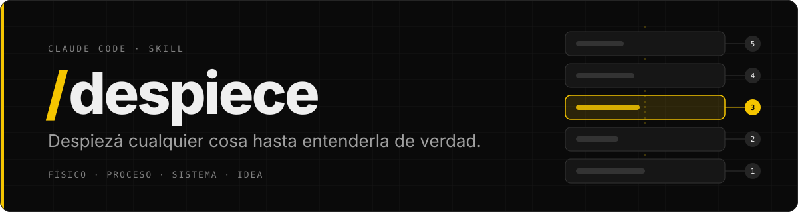
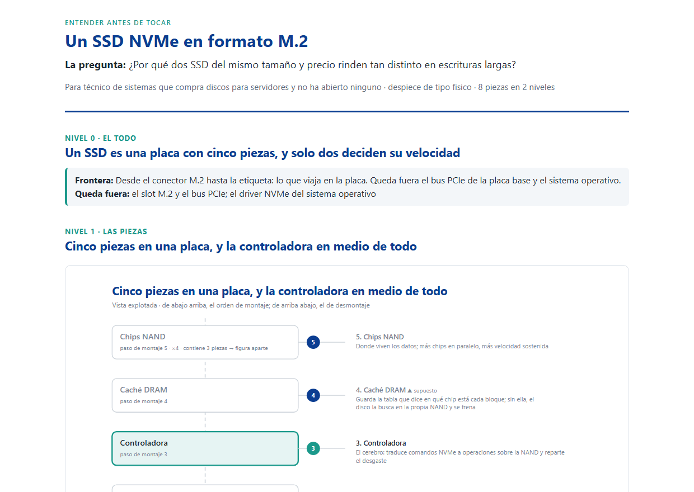
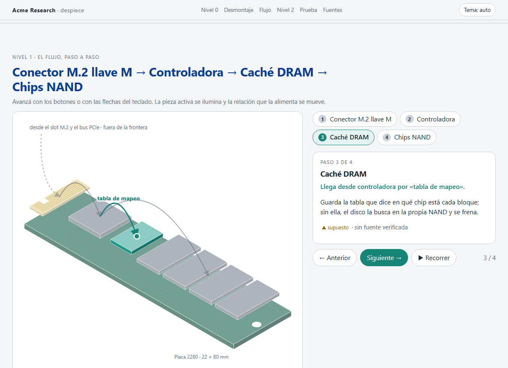

<div align="center">



<br>

**README** · [**Demo**](docs/demo.md) · [**Interactiva**](docs/interactivo.md) · [**Instalación**](docs/instalacion.md) · [**Changelog**](CHANGELOG.md) · [**Licencia**](LICENSE)

<br>

[](CHANGELOG.md)
[](LICENSE)
[](https://claude.com/claude-code)
[](scripts/)
[](https://t28.io)

<br>

Una skill de [Claude Code](https://claude.com/claude-code) que convierte «no entiendo cómo funciona esto»
en una explicación por niveles, con figuras, fuentes y dos pruebas de que lo entendiste.

</div>

---

## El problema

Pedile a una IA que te explique cómo funciona algo y te devuelve un muro de texto: definiciones primero,
todo a la vez, sin decir de dónde sacó cada cosa y sin forma de saber si lo entendiste o solo lo leíste.

Los buenos explicadores no hacen eso. Un ilustrador técnico explota una máquina pieza por pieza. Un
profesor nombra las partes antes de explicar el mecanismo. Un divulgador te hace predecir antes de
revelar. **`despiece` mete esa disciplina dentro de Claude Code.**

## Qué hace

Con unas palabras («despiezame la Application Gateway», «cómo funciona por dentro un SSD», «no veo cómo
encaja PIM»), la skill:

1. **Encuadra antes de dibujar.** Qué tiene que poder hacer el lector después, quién es y hasta dónde
   bajar. Tres preguntas como máximo; ninguna si el contexto ya las responde.
2. **Clasifica el objeto.** Físico, proceso, sistema o idea. Cada tipo tiene su eje y su técnica.
3. **Busca fuentes.** Documentación oficial, hojas de datos, el repo del proyecto, la configuración real
   en solo lectura. Lo que no tiene fuente se marca como supuesto, pieza a pieza. **Nada se explica de
   memoria.**
4. **Modela.** Un `modelo.json` con el todo y su frontera, de 3 a 7 piezas por nivel con su función y su
   fuente, y el flujo que las une. Un validador lo revisa contra las reglas del método.
5. **Dibuja una figura por nivel.** Vista explotada propia para hardware; flujo, calles, capas o árbol
   delegados a la skill de dibujo que tengas instalada, o a un script propio.
6. **Ensambla una página** HTML con tema claro y oscuro, las figuras incrustadas y tu marca si querés. Para
   hardware, también una **interactiva** que se abre, se desmonta al bajar y recorre el flujo.
7. **Comprueba que se entendió.** Tres frases que un no experto seguiría y una pregunta de predicción con
   la respuesta plegada al final.

## Así se ve

Un SSD NVMe, despiezado para un técnico que compra discos y nunca abrió ninguno. La pregunta foco: *¿por
qué dos SSD del mismo tamaño y precio rinden tan distinto en escrituras largas?*

<div align="center">

[](docs/demo.md)

</div>

> **Nivel 0 · Un SSD es una placa con cinco piezas, y solo dos deciden su velocidad.**
>
> **En tres frases.** Un SSD es una placa con una controladora que reparte los datos entre varios chips de
> memoria. Va rápido mientras escribe en paralelo en muchos chips y tiene a mano la tabla de dónde está
> cada cosa. Cuando la caché rápida se llena o no hay DRAM, el disco baja a la velocidad real de sus celdas.
>
> **Ponete a prueba.** Dos SSD de 1 TB: uno con 4 chips NAND y DRAM, otro con 2 chips y sin DRAM. Copiás
> 200 GB seguidos. ¿Cuál se frena antes y por qué?

La página completa, en claro y en oscuro, las dos vistas explotadas y el modelo del que sale todo están en
la [**Demo**](docs/demo.md). Y se reproduce en tu máquina con tres comandos, sin Claude.

El mismo modelo, con unas medidas más, sale como página interactiva: una vista isométrica que se abre sola,
se desmonta pieza a pieza al bajar, recorre el flujo paso a paso y deja entrar en la NAND.

<div align="center">

[](docs/interactivo.md)

</div>

Capturas en claro, oscuro, móvil y sin JavaScript en [**Interactiva**](docs/interactivo.md).

## Lo que obtenés

| Fichero | Qué es |
|---|---|
| `modelo.json` | La única fuente de verdad: piezas, funciones, fuentes, relaciones, flujo, malentendidos |
| `figuras/*.svg` | Una por nivel. Vectoriales, sin tamaño fijo, listas para incrustar donde quieras |
| `index.html` | La explicación completa, autocontenida, claro y oscuro, con la predicción plegada. Con `--interactivo`, la versión que se abre y se recorre |

Y en la conversación, lo esencial: el título del nivel 0, las tres frases y la pregunta de predicción.

## Cuatro tipos de cosa, cuatro formas de abrirla

| Tipo | Ejemplos | Eje | Figura |
|---|---|---|---|
| **Físico** | un SSD, un firewall, una Raspberry Pi | espacial | vista explotada numerada (la dibuja la skill) |
| **Proceso** | una activación por PIM, un despliegue, un alta | temporal | flujo o calles |
| **Sistema** | una arquitectura, una red, el camino de una petición | funcional y de flujo | flujo, capas, C4 |
| **Idea** | un concepto, un patrón, una decisión de diseño | lógico | árbol MECE, mapa conceptual |

Los casos mixtos los decide la pregunta foco: un firewall es físico para «qué cable va dónde» y sistema
para «por qué bloquea esto».

## Instalación

Un `git clone` en la carpeta de skills de Claude Code y listo. En macOS o Linux:

```bash
git clone https://github.com/javierledesma28/skill-despiece.git ~/.claude/skills/despiece
```

En Windows, con PowerShell:

```powershell
git clone https://github.com/javierledesma28/skill-despiece.git "$env:USERPROFILE\.claude\skills\despiece"
```

Hace falta Claude Code y Python 3.10 o superior. **Sin dependencias de pip.** Node 22 o superior, solo para
capturar la página interactiva. El paso a paso completo,
con la instalación sin Git, cómo comprobar que quedó bien, actualizar, desinstalar y qué hacer si algo
falla, está en [**Instalación**](docs/instalacion.md).

## Uso

Dentro de Claude Code, con el comando o con tus palabras:

```
/despiece el túnel VPN entre la oficina y la nube
```

```
no entiendo cómo funciona por dentro un SSD NVMe, desmenuzámelo
```

```
qué partes tiene una Raspberry Pi 5 y qué hace cada una, para la ficha del taller
```

Se activa con «despiezá», «desmenuzá», «desarmá», «cómo funciona por dentro», «qué partes tiene»,
«anatomía de», «explicámelo para entenderlo», «no veo cómo encaja»… aunque no digas «despiece». Si pedís
algo corto («en dos párrafos»), aplica el mismo método pero responde en texto, sin montar la página.

## Tu marca, en un fichero

La skill no trae la marca de nadie. Si querés la tuya, un JSON:

```json
{
  "nombre": "Acme Research",
  "primario": "#0b3d91",
  "secundario": "#1b998b",
  "fuente": "'Segoe UI', system-ui, sans-serif",
  "pie": "Acme Research · Documentación técnica interna",
  "lema": "ENTENDER ANTES DE TOCAR"
}
```

y `--marca ruta/a/marca.json` en `explosionado.py` y `ensamblar.py`. Sin el flag, o con `--marca ninguna`,
la página sale neutra. Los colores se aclaran solos en tema oscuro para seguir leyéndose.

## Skills de dibujo: opcionales

`despiece` es una capa de **comprensión**, no de dibujo: decide qué se muestra, en qué orden y con qué
figura. Para hardware dibuja ella misma la vista explotada. Para el resto entrega un **guion** (título
afirmativo, piezas exactas, relaciones, pieza destacada, ruta de salida) a la skill de dibujo que tengas
instalada, por ejemplo una de diagramas editoriales para flujos, calles, capas y árboles. Si no tenés
ninguna, dibuja con un script propio siguiendo el guion. Las reglas están en
[`references/guion-visual.md`](references/guion-visual.md).

## El método, y de dónde sale

Vistas explotadas de Agrawala y Li (SIGGRAPH 2003 y 2008) y Stephen Biesty para lo físico; IDEF0 e
instrucciones paso a paso para procesos; C4, FAST y la tradición *what happens when* para sistemas; MECE,
mapas conceptuales de Novak y la técnica de Feynman para ideas. Encima, la ciencia de aprender con figuras:
Mayer (nombrar antes de explicar, señalizar, segmentar), Sweller (de 3 a 7 por nivel), Distill (predecir
antes de revelar) y los anti-patrones de Julia Evans y Nicky Case. Y lo que se tomó y lo que se descartó de
ocho skills de explicación visual. Todo trazado regla por regla en
[`references/fuentes.md`](references/fuentes.md).

## Qué tan bien funciona

Medido, no prometido. Los cuatro casos públicos de [`evals/evals.json`](evals/evals.json) (una WAF delante
de un portal, una Raspberry Pi 5, la activación de un rol por PIM y la idempotencia en una API de pagos),
ejecutados el 2026-11-02 con y sin la skill en subagentes limpios de Sonnet, más el caso físico repetido
con Haiku:

| | Con skill | Sin skill |
|---|---|---|
| Aserciones cumplidas, Sonnet (4 casos) | **26 / 26** | 16 / 26 |
| Aserciones cumplidas, Haiku (caso físico) | **7 / 7** | 2 / 7 |
| Activación correcta (20 consultas × 3 modelos) | **60 / 60** | — |
| Página interactiva, Sonnet y Haiku (caso 5, 1.2.0) | **8 / 8 y 8 / 8** | 4 / 8 y 4 / 8 |
| Activación con 22 consultas (1.2.0, × 3 modelos) | **64 / 66** | — |

Sin la skill, el modelo explica bien, cita fuentes y a veces cierra con una pregunta, pero no modela por niveles,
no marca supuestos pieza a pieza ni deriva las figuras de un guion con las piezas exactas. Con la skill, hasta Haiku entrega el modelo
validado, la vista explotada con una sola pieza destacada y las dos puertas de comprensión. Detalle,
evidencia y limitaciones en [`evals/resultados-2026-11-02.md`](evals/resultados-2026-11-02.md); los de la
1.0, en [`evals/resultados-2026-11-01.md`](evals/resultados-2026-11-01.md).

En la página interactiva, sin la skill los dos modelos arman una página que se recorre con el scroll y lleva
la marca, pero sin modelo ni pregunta foco, con la figura vacía si no hay JavaScript y sin las puertas de
comprensión. Los dos fallos de activación son la misma consulta: una página «que se recorra con el scroll,
tipo 3D» se va a la guía web. Para la interactiva, conviene pedir el despiece de forma explícita. Detalle en
[`evals/resultados-2026-11-02b.md`](evals/resultados-2026-11-02b.md).

## Hoja de ruta

- [x] Correr las evals públicas (calidad y activación) y publicar los resultados.
- [x] Un caso con Haiku como ejecutor.
- [x] Capturas de un despiece de punta a punta ([Demo](docs/demo.md)).
- [x] Una página mucho más visual e interactiva: la vista explotada que se abre y se cierra, los flujos que
      se recorren pieza a pieza y niveles en los que uno entra con el scroll ([Interactiva](docs/interactivo.md),
      para hardware).
- [x] Vista isométrica, en la página interactiva.
- [ ] La página interactiva para procesos, sistemas e ideas.
- [ ] Cortes con trama y giro de la vista explotada.
- [ ] Vídeo de un despiece de punta a punta.

¿Lo usaste para algo? Abrí un issue con tu `modelo.json`: los buenos despieces se convierten en ejemplos.

## Licencia

[MIT](LICENSE). Usalo, modificalo, compartilo.

---

<div align="center">

<a href="https://t28.io">
<picture>
  <source media="(prefers-color-scheme: dark)" srcset="https://t28.io/press-kit/logos/think28-logo-primary-dark.svg">
  
</picture>
</a>

**Digital Growth Partner**

Un desarrollo de [**Think28**](https://t28.io) · hecho con Claude Code y amor

</div>
