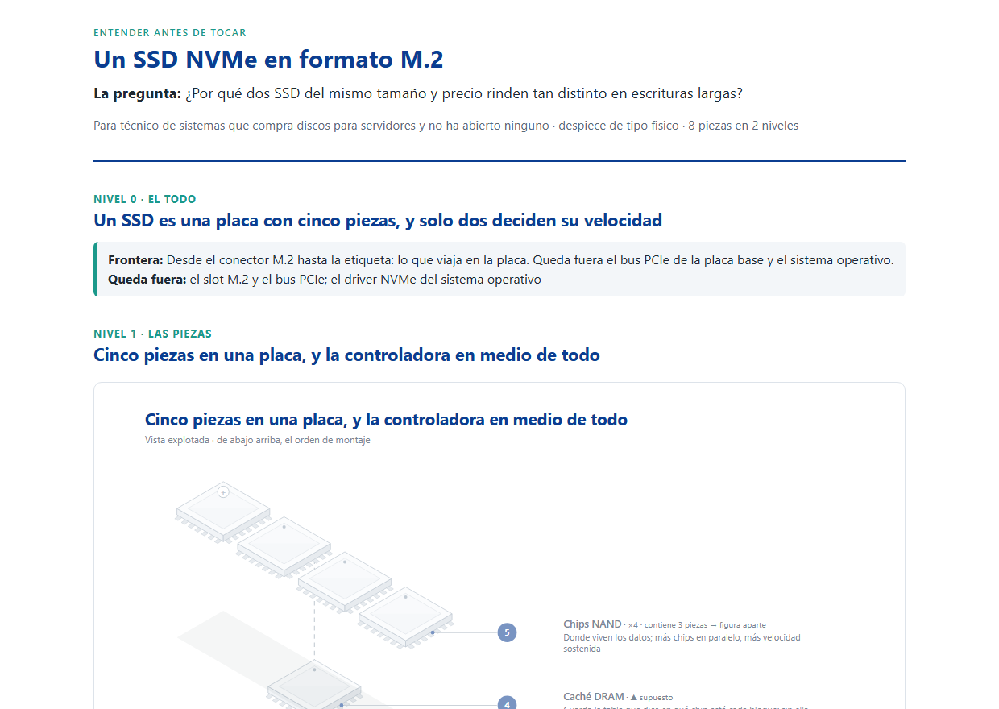
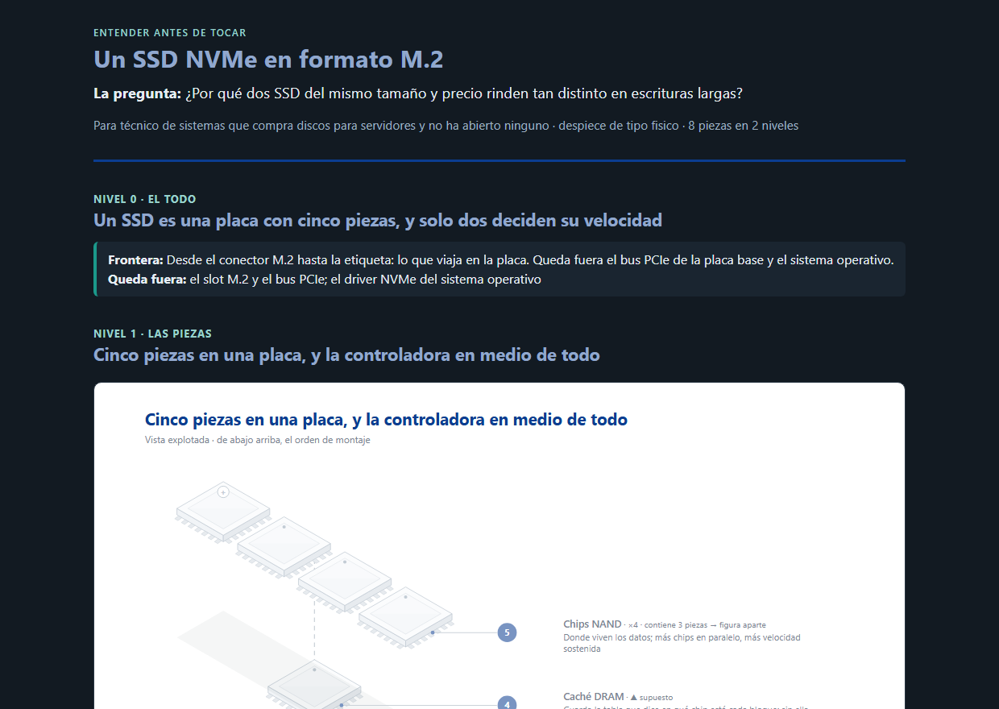
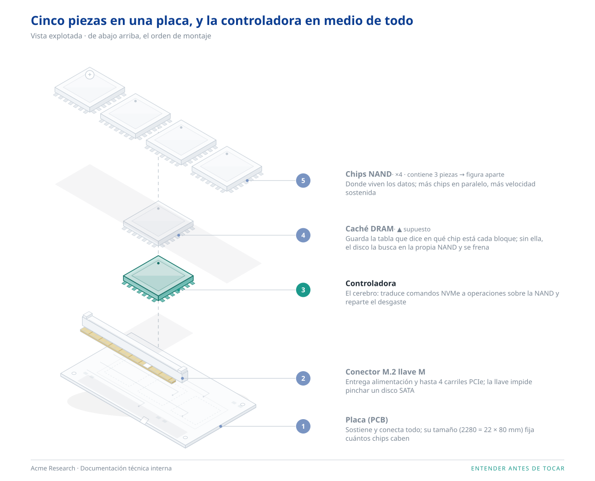
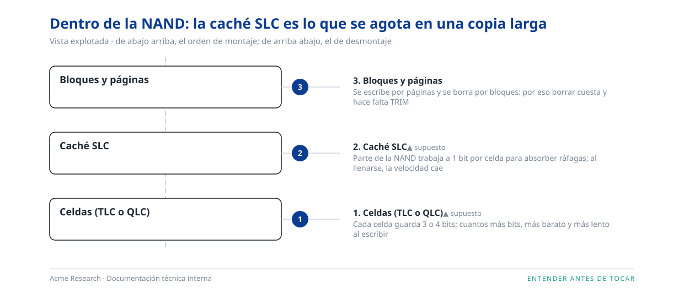

<div align="center">

[**← README**](../README.md) · **Demo** · [**Interactiva**](interactivo.md) · [**Instalación**](instalacion.md) · [**Changelog**](../CHANGELOG.md) · [**Licencia**](../LICENSE)

</div>

# Así se ve un despiece

Lo que la skill deja al terminar no es un chat: es una carpeta con tres cosas que podés abrir, incrustar o
versionar.

| Fichero | Qué es | En esta demo |
|---|---|---|
| `modelo.json` | La única fuente de verdad: piezas con función y fuente, relaciones, flujo, malentendidos | [`assets/ejemplo-fisico.json`](../assets/ejemplo-fisico.json) |
| `figuras/*.svg` | Una por nivel, vectorial, sin tamaño fijo | [`n1-explosion.svg`](demo/figuras/n1-explosion.svg) · [`n2-nand.svg`](demo/figuras/n2-nand.svg) |
| `index.html` | La explicación entera, autocontenida, tema claro y oscuro | [`demo/index.html`](demo/index.html) (descargalo y abrilo) |

## El caso: un SSD NVMe

Pregunta foco: *¿por qué dos SSD del mismo tamaño y precio rinden tan distinto en escrituras largas?* Lector: un
técnico de sistemas que compra discos para servidores y nunca abrió uno. Tipo físico, dos niveles, con la marca de
ejemplo de la skill (Acme Research).

### La página

Arranca por el todo y su frontera, no por una definición. Cada nivel tiene su figura y, debajo, la lista numerada
con la función y la fuente de cada pieza. Lo que no tiene fuente va marcado como **▲ supuesto**.

<p align="center">
  
</p>

El mismo fichero, con el sistema en oscuro. Las figuras siguen sobre lámina blanca para que se lean igual:

<p align="center">
  
</p>

### Las figuras

**Nivel 1.** Las cinco piezas en orden de montaje, de abajo arriba, con la controladora destacada porque es la que
responde a la pregunta. Una pieza con hijos se dibuja cerrada y se abre en su propia figura.

<p align="center">
  
</p>

**Nivel 2.** Dentro de la NAND, que es donde cambia la respuesta: la caché SLC es lo que se agota en una copia
larga.

<p align="center">
  
</p>

### El cierre

Al final de la página (y en la conversación) van las dos puertas de comprensión:

> **En tres frases.** Un SSD es una placa con una controladora que reparte los datos entre varios chips de memoria.
> Va rápido mientras escribe en paralelo en muchos chips y tiene a mano la tabla de dónde está cada cosa. Cuando la
> caché rápida se llena o no hay DRAM, el disco baja a la velocidad real de sus celdas.
>
> **Ponete a prueba.** Dos SSD de 1 TB: uno con 4 chips NAND y DRAM, otro con 2 chips y sin DRAM. Copiás 200 GB
> seguidos. ¿Cuál se frena antes y por qué? *(La respuesta está plegada en la página.)*

Páginas completas: [tema claro](demo/pagina-claro.png) · [tema oscuro](demo/pagina-oscuro.png).

La misma explicación como página que se abre, se desmonta al bajar y recorre el flujo: [**Interactiva**](interactivo.md).

## Reproducilo en tu máquina

Sin Claude: los scripts funcionan solos.

```bash
cd ~/.claude/skills/despiece
python -I scripts/validar_modelo.py assets/ejemplo-fisico.json
mkdir -p demo/figuras
python -I scripts/explosionado.py assets/ejemplo-fisico.json --salida demo/figuras/n1-explosion.svg --destacar controladora --marca assets/marca-ejemplo.json
python -I scripts/explosionado.py assets/ejemplo-fisico.json --salida demo/figuras/n2-nand.svg --subconjunto nand --marca assets/marca-ejemplo.json
python -I scripts/ensamblar.py assets/ejemplo-fisico.json --salida demo/index.html --figuras demo --marca assets/marca-ejemplo.json
```

Abrí `demo/index.html`. Cambiá el tema del sistema y mirá cómo se adapta. Quitá `--marca …` (o poné
`--marca ninguna`) y sale neutra.

Con Claude Code, el mismo resultado se pide así:

```
/despiece un SSD NVMe: quiero entender qué pieza decide la velocidad en escrituras largas
```

## Los otros tres tipos

La misma vista explotada sirve para una red, una historia, una auditoría o un sentido del cuerpo: los nueve
ejemplos, nivel por nivel y con el comando de cada figura, están en [**Ejemplos**](ejemplos.md).

Un sistema (el camino de una petición hasta un portal detrás de una WAF), un proceso (la activación de un rol por
PIM) y una idea (la idempotencia en una API de pagos) son además los casos de evaluación públicos de la skill. Cómo
salen, con y sin la skill, en [`evals/resultados-2026-11-02.md`](../evals/resultados-2026-11-02.md).

---

<div align="center">

Un desarrollo de [**Think28**](https://t28.io) · hecho con Claude Code y amor

</div>
