# Ejemplos

Un modelo por clase de caso, todos válidos con `validar_modelo.py` y con fuentes. La skill **no sabe de
ninguno de estos dominios**: lo que cambia de uno a otro es el vocabulario. Los dos ejes son siempre los
mismos, qué tiene que existir antes (`orden`, que el campo `eje` nombra en el subtítulo) y qué está dentro
de qué (`padre`); el `rol` de cada pieza elige su silueta.

Cada figura sale de este comando, desde la carpeta de la skill:

```bash
python -I scripts/explosionado.py assets/ejemplo-<caso>.json --salida <figura>.svg [--subconjunto <id>] [--destacar <id>]
```

| Caso | Tipo | `orden` es… | Niveles | Modelo |
|---|---|---|---|---|
| Un aparato | físico | el orden de montaje (sin `eje`, el del tipo) | 2 | [`ejemplo-fisico.json`](../assets/ejemplo-fisico.json) |
| Una red en la nube | sistema | el despliegue, de la red a las máquinas | 2 | [`ejemplo-red-nube.json`](../assets/ejemplo-red-nube.json) |
| La historia de un país | proceso | la cronología, de lo más antiguo a lo más reciente | 4 | [`ejemplo-historia-argentina.json`](../assets/ejemplo-historia-argentina.json) |
| Un árbol genealógico | idea | las generaciones, de la más antigua a la más reciente | 3 | [`ejemplo-arbol-genealogico.json`](../assets/ejemplo-arbol-genealogico.json) |
| Una auditoría | proceso | las fases de la certificación, de la preparación al ciclo de tres años | 4 | [`ejemplo-auditoria-iso27001.json`](../assets/ejemplo-auditoria-iso27001.json) |
| Un proceso de software | proceso | el orden de los pasos, del commit a producción | 2 | [`ejemplo-cicd.json`](../assets/ejemplo-cicd.json) |
| Un terreno | físico | la profundidad, de lo más hondo a la superficie | 2 | [`ejemplo-terreno-marte.json`](../assets/ejemplo-terreno-marte.json) |
| Un sentido del cuerpo | sistema | la cadena de la señal, de la piel a la corteza | 2 | [`ejemplo-tacto.json`](../assets/ejemplo-tacto.json) |
| Un sistema web | sistema | el camino de la petición, de la entrada al portal | 2 | [`ejemplo-sistema.json`](../assets/ejemplo-sistema.json) |

## Un aparato: un SSD NVMe en formato M.2

**Pregunta foco.** ¿Por qué dos SSD del mismo tamaño y precio rinden tan distinto en escrituras largas?

**Nivel 0.** Un SSD es una placa con cinco piezas, y solo dos deciden su velocidad

<a href="demo/iso/n1-explosion.svg">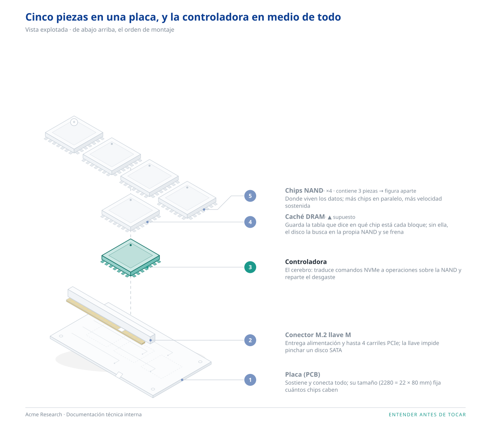</a>

<sub>Nivel 1, las raíces: `--destacar controladora`</sub>

<a href="demo/iso/n2-nand.svg">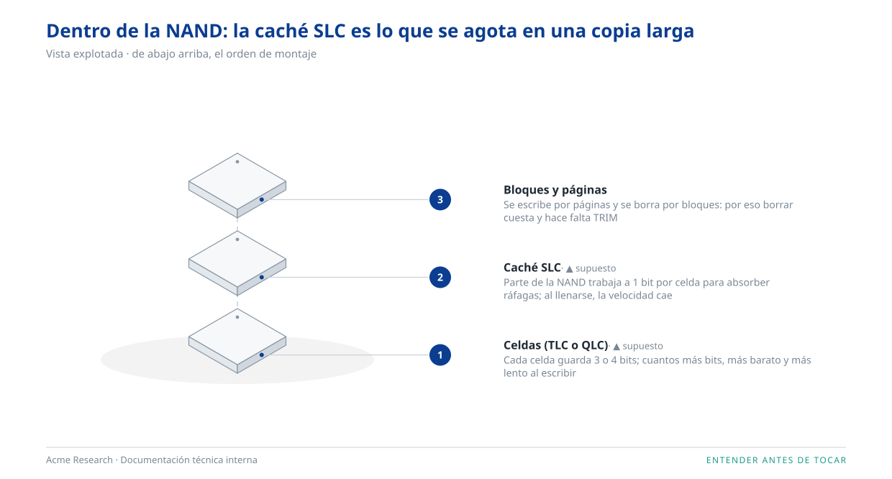</a>

<sub>Nivel 2, dentro de «Chips NAND»: `--subconjunto nand --destacar nand-slc`</sub>

## Una red en la nube: una red radial (spoke) de Azure unida a la oficina por el VPN Gateway de la red central (hub)

**Pregunta foco.** ¿Por qué una máquina de una red radial no llega a la oficina por el túnel VPN aunque el peering esté conectado?

**Nivel 0.** Una máquina radial llega a la oficina solo si el peering le presta el túnel de la central

<a href="demo/ejemplos/red-nube-n1-explosion.svg">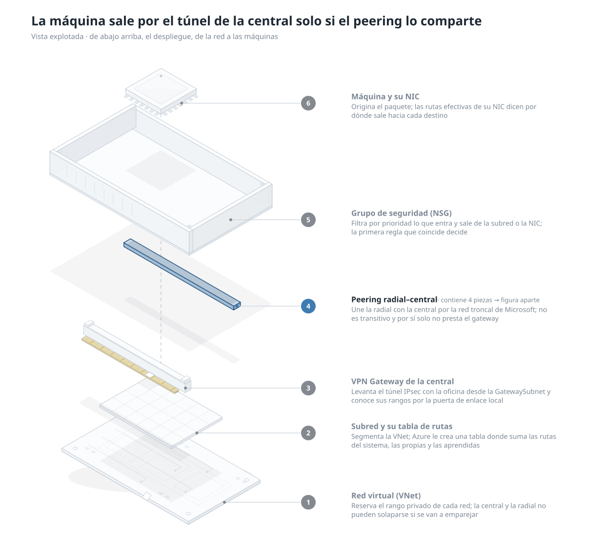</a>

<sub>Nivel 1, las raíces: `--destacar peering`</sub>

<a href="demo/ejemplos/red-nube-n2-peering.svg">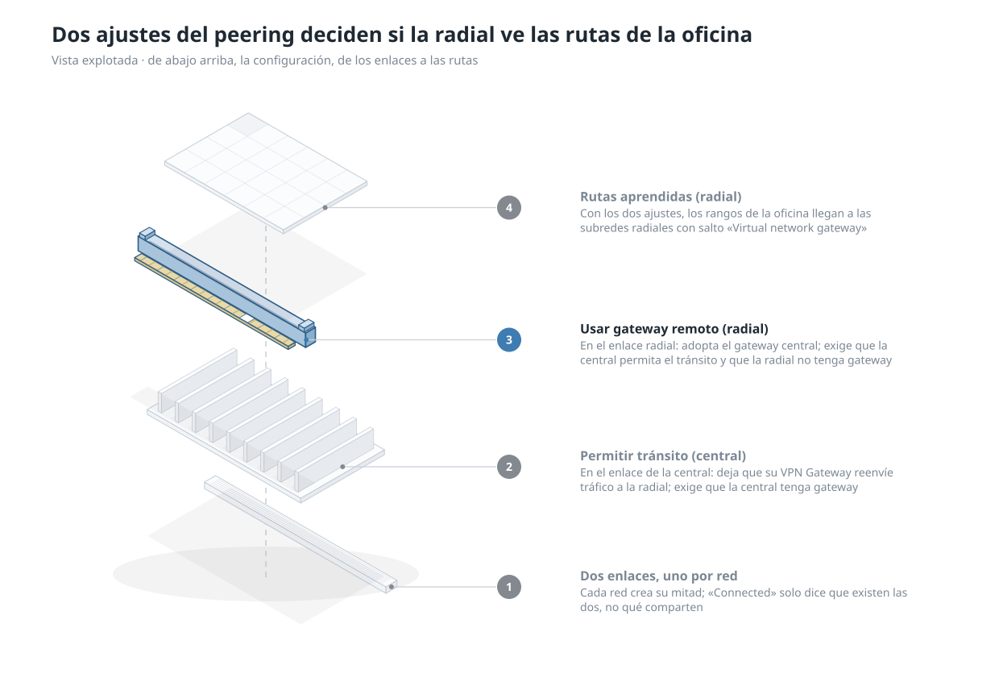</a>

<sub>Nivel 2, dentro de «Peering radial–central»: `--subconjunto peering --destacar peering-remoto`</sub>

## La historia de un país: la historia política argentina, 1826–2026

**Pregunta foco.** ¿Por qué la Argentina alternó tantas veces entre gobiernos civiles y militares en el siglo XX?

**Nivel 0.** En dos siglos, la Argentina pasó de las guerras civiles a más de 40 años sin golpes

<a href="demo/ejemplos/historia-argentina-n1-explosion.svg">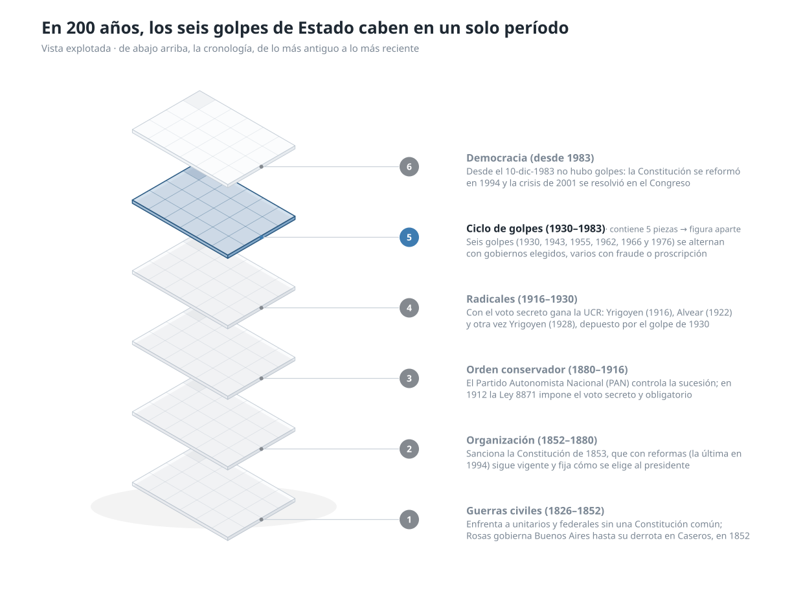</a>

<sub>Nivel 1, las raíces: `--destacar golpes`</sub>

<a href="demo/ejemplos/historia-argentina-n2-golpes.svg">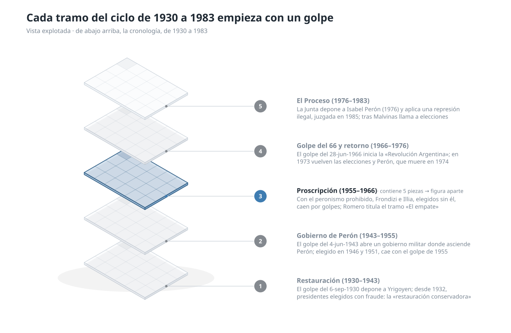</a>

<sub>Nivel 2, dentro de «Ciclo de golpes (1930–1983)»: `--subconjunto golpes --destacar t1955`</sub>

<a href="demo/ejemplos/historia-argentina-n3-t1955.svg">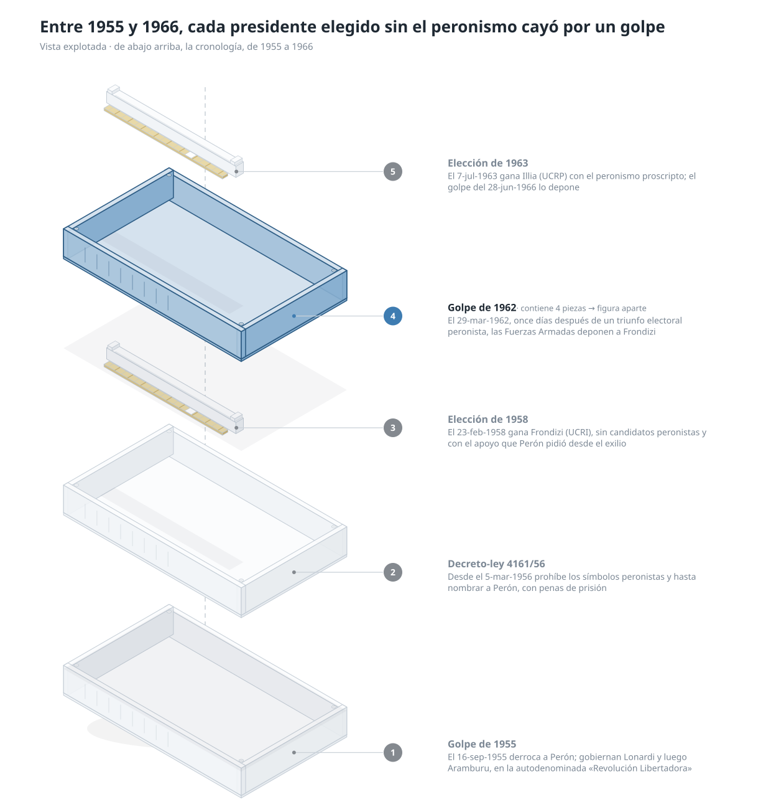</a>

<sub>Nivel 3, dentro de «Proscripción (1955–1966)»: `--subconjunto t1955 --destacar golpe-1962`</sub>

<a href="demo/ejemplos/historia-argentina-n4-golpe-1962.svg">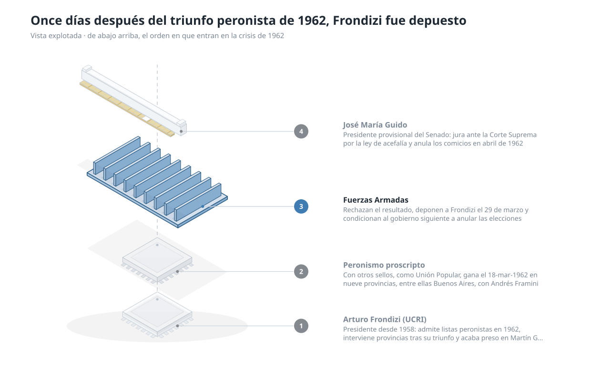</a>

<sub>Nivel 4, dentro de «Golpe de 1962»: `--subconjunto golpe-1962 --destacar ffaa`</sub>

## Un árbol genealógico: la familia Darwin–Wedgwood, de los abuelos a los hijos de Charles

**Pregunta foco.** ¿Por qué Charles Darwin temía que sus hijos heredaran una salud frágil?

**Nivel 0.** Dos bodas cruzaron a los Darwin con los Wedgwood, y la segunda unió a dos primos hermanos

<a href="demo/ejemplos/arbol-genealogico-n1-explosion.svg">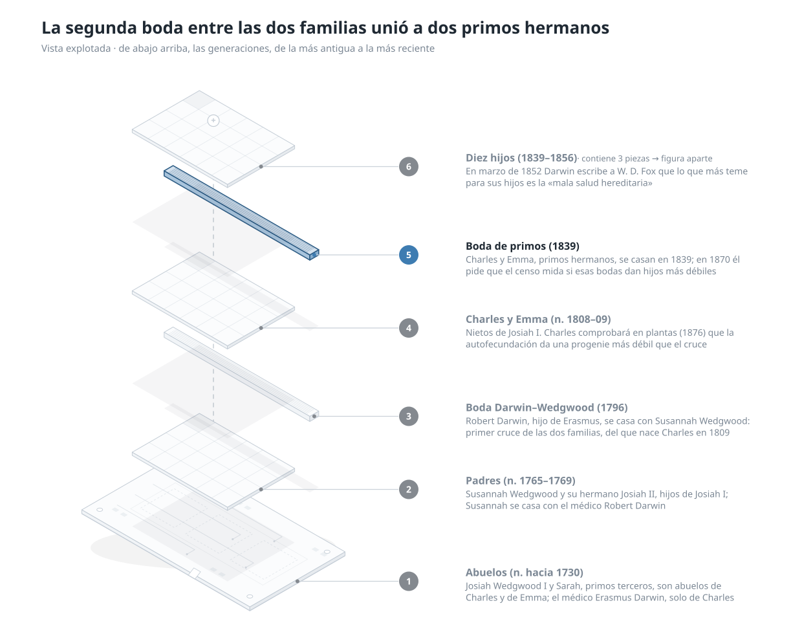</a>

<sub>Nivel 1, las raíces: `--destacar boda-1839`</sub>

<a href="demo/ejemplos/arbol-genealogico-n2-hijos.svg">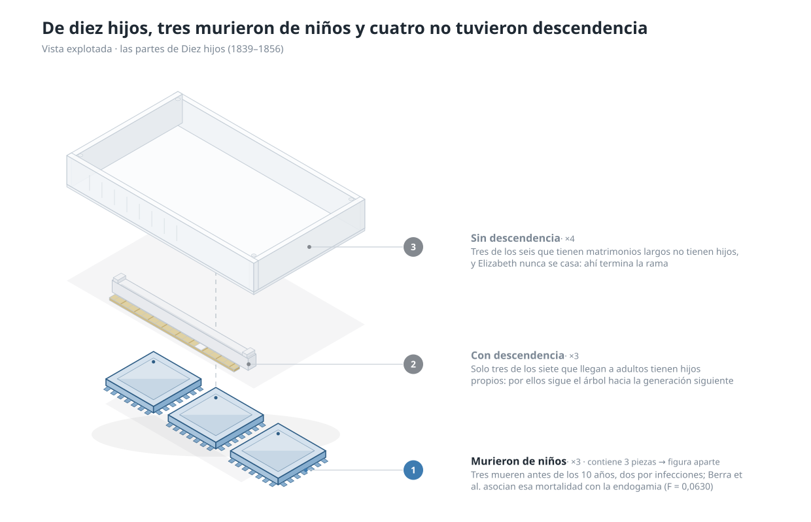</a>

<sub>Nivel 2, dentro de «Diez hijos (1839–1856)»: `--subconjunto hijos --destacar ninos`</sub>

<a href="demo/ejemplos/arbol-genealogico-n3-ninos.svg">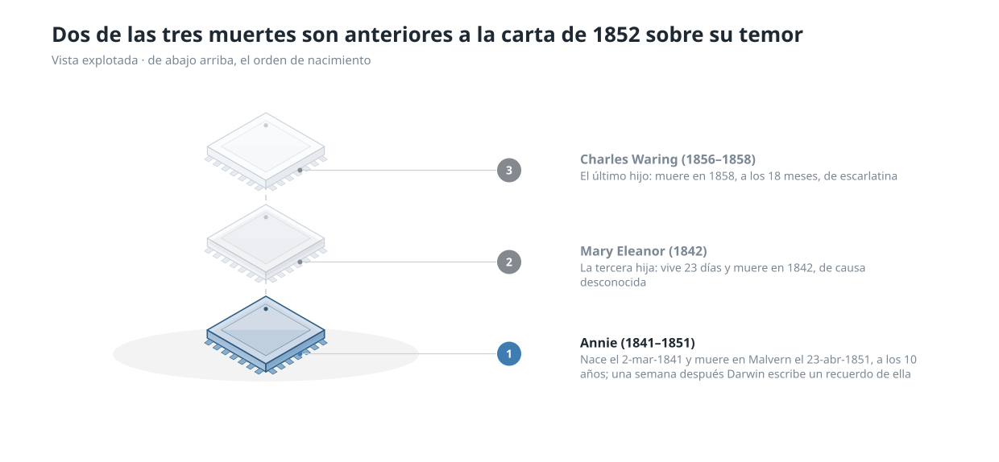</a>

<sub>Nivel 3, dentro de «Murieron de niños»: `--subconjunto ninos --destacar annie`</sub>

## Una auditoría: la auditoría de certificación ISO/IEC 27001:2022

**Pregunta foco.** ¿Por qué una organización con todas sus políticas escritas puede no pasar la etapa 2?

**Nivel 0.** Certificarse en ISO 27001 es demostrar con pruebas que lo escrito se cumple

<a href="demo/ejemplos/auditoria-iso27001-n1-explosion.svg">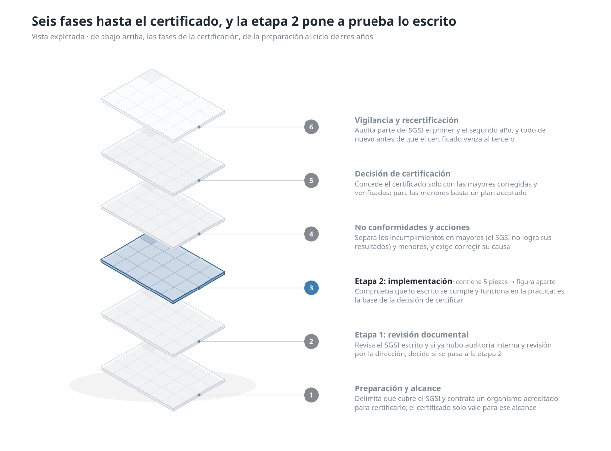</a>

<sub>Nivel 1, las raíces: `--destacar etapa2`</sub>

<a href="demo/ejemplos/auditoria-iso27001-n2-etapa2.svg">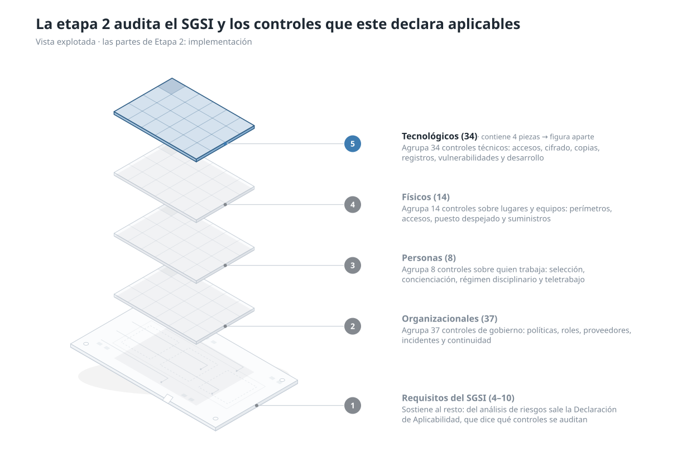</a>

<sub>Nivel 2, dentro de «Etapa 2: implementación»: `--subconjunto etapa2 --destacar tecnologicos`</sub>

<a href="demo/ejemplos/auditoria-iso27001-n3-tecnologicos.svg">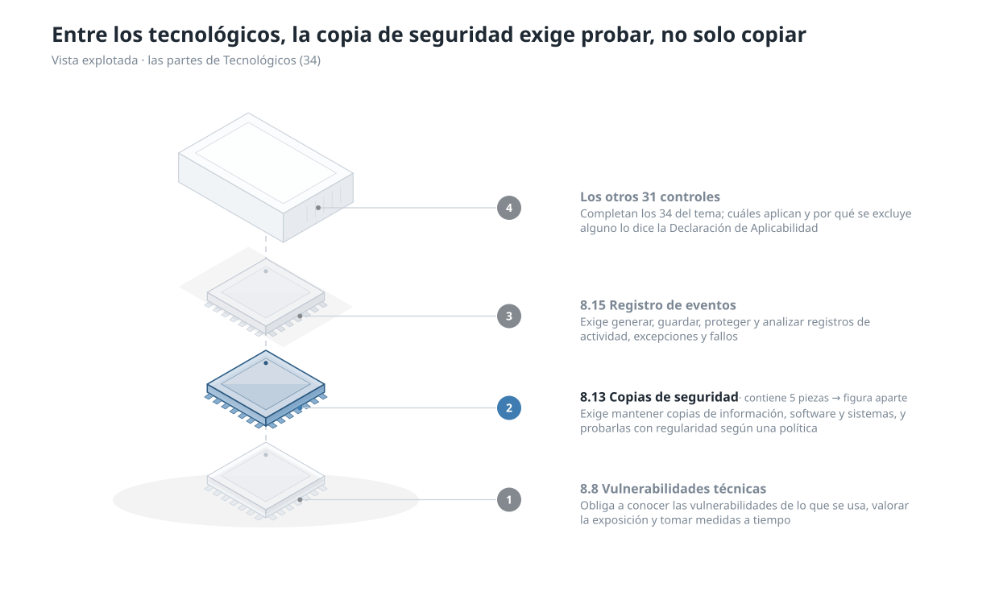</a>

<sub>Nivel 3, dentro de «Tecnológicos (34)»: `--subconjunto tecnologicos --destacar c8-13`</sub>

<a href="demo/ejemplos/auditoria-iso27001-n4-c8-13.svg">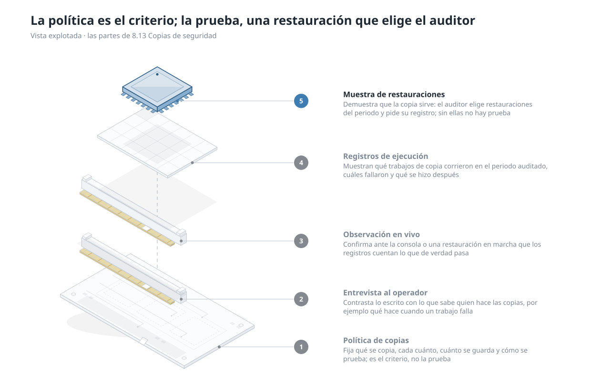</a>

<sub>Nivel 4, dentro de «8.13 Copias de seguridad»: `--subconjunto c8-13 --destacar muestra-restauracion`</sub>

## Un proceso de software: un pipeline de CI/CD que lleva un cambio del commit a producción

**Pregunta foco.** ¿Por qué un cambio que pasó todas las pruebas rompe en producción?

**Nivel 0.** Las pruebas validan el artefacto, y producción le cambia la configuración, los secretos y los datos

<a href="demo/ejemplos/cicd-n1-explosion.svg">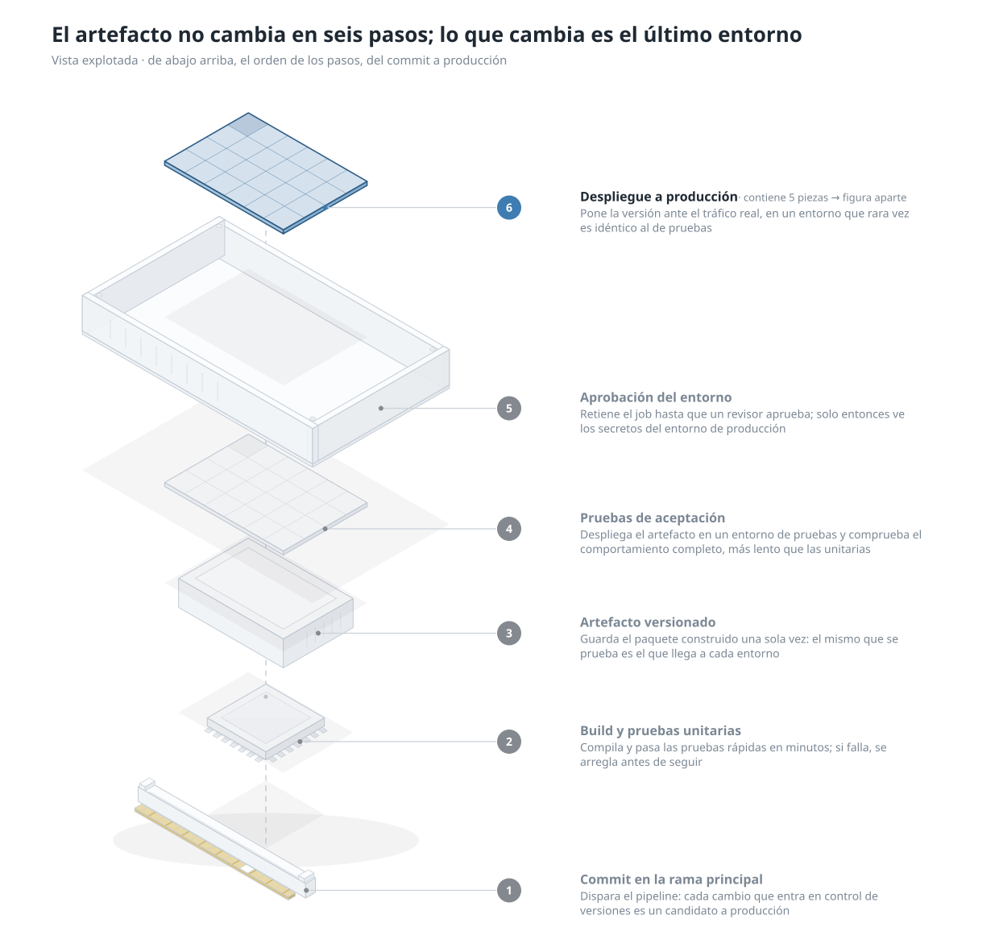</a>

<sub>Nivel 1, las raíces: `--destacar prod`</sub>

<a href="demo/ejemplos/cicd-n2-prod.svg">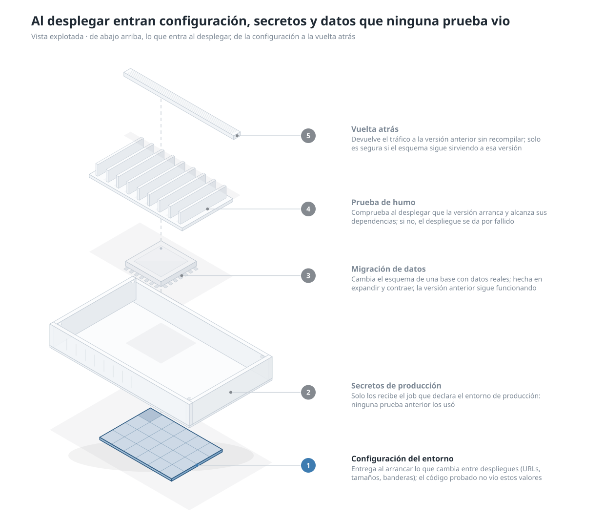</a>

<sub>Nivel 2, dentro de «Despliegue a producción»: `--subconjunto prod --destacar prod-config`</sub>

## Un terreno: el subsuelo de Marte, del polvo a la corteza

**Pregunta foco.** ¿Por qué una sonda que excava unos centímetros en Marte puede encontrar hielo y otra, a otra latitud, no?

**Nivel 0.** Bajo el polvo de Marte hay cinco capas, y la del hielo cambia de hondura con la latitud

<a href="demo/ejemplos/terreno-marte-n1-explosion.svg">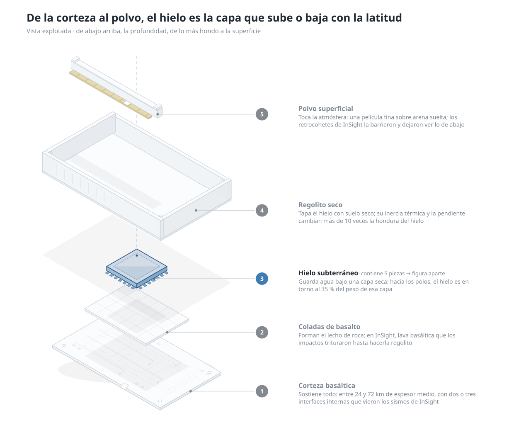</a>

<sub>Nivel 1, las raíces: `--destacar hielo`</sub>

<a href="demo/ejemplos/terreno-marte-n2-hielo.svg">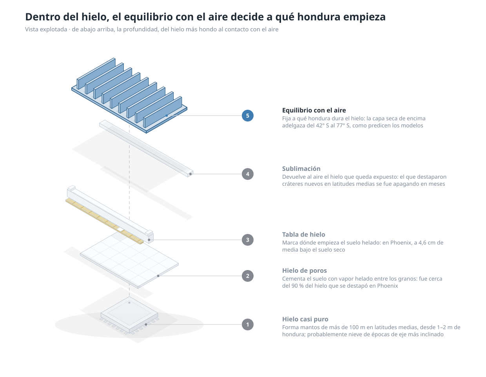</a>

<sub>Nivel 2, dentro de «Hielo subterráneo»: `--subconjunto hielo --destacar hielo-equilibrio`</sub>

## Un sentido del cuerpo: el sentido del tacto, de la piel a la corteza

**Pregunta foco.** ¿Por qué se distinguen dos puntas en la yema del dedo y no en la espalda?

**Nivel 0.** El tacto fino sube por una cadena de tres neuronas, y su agudeza se decide en la piel

<a href="demo/ejemplos/tacto-n1-explosion.svg">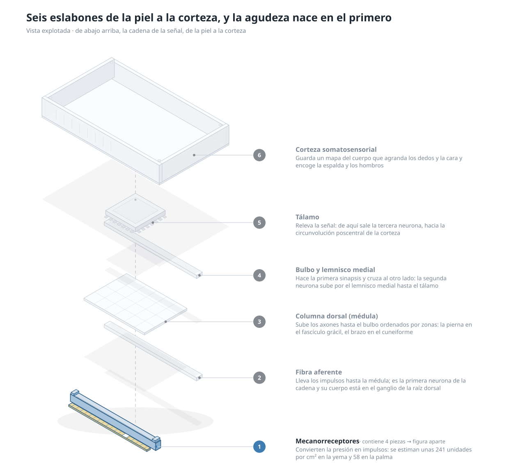</a>

<sub>Nivel 1, las raíces: `--destacar receptores`</sub>

<a href="demo/ejemplos/tacto-n2-receptores.svg">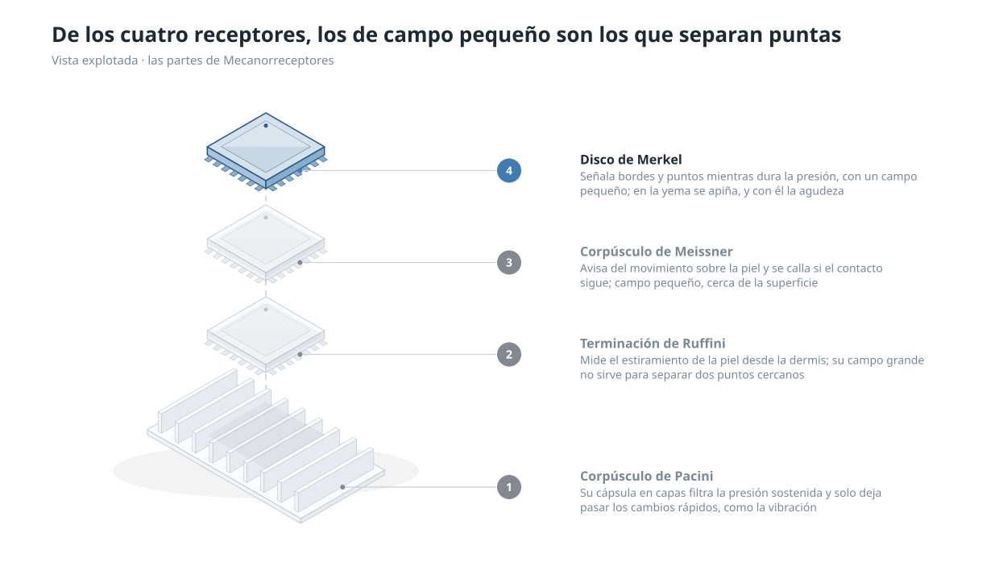</a>

<sub>Nivel 2, dentro de «Mecanorreceptores»: `--subconjunto receptores --destacar merkel`</sub>

## Un sistema web: el camino de una petición web por una Application Gateway con WAF

**Pregunta foco.** ¿Por qué una petición puede llegar al portal sin que la WAF la vea?

**Nivel 0.** La WAF solo inspecciona lo que entra por la puerta de la gateway
