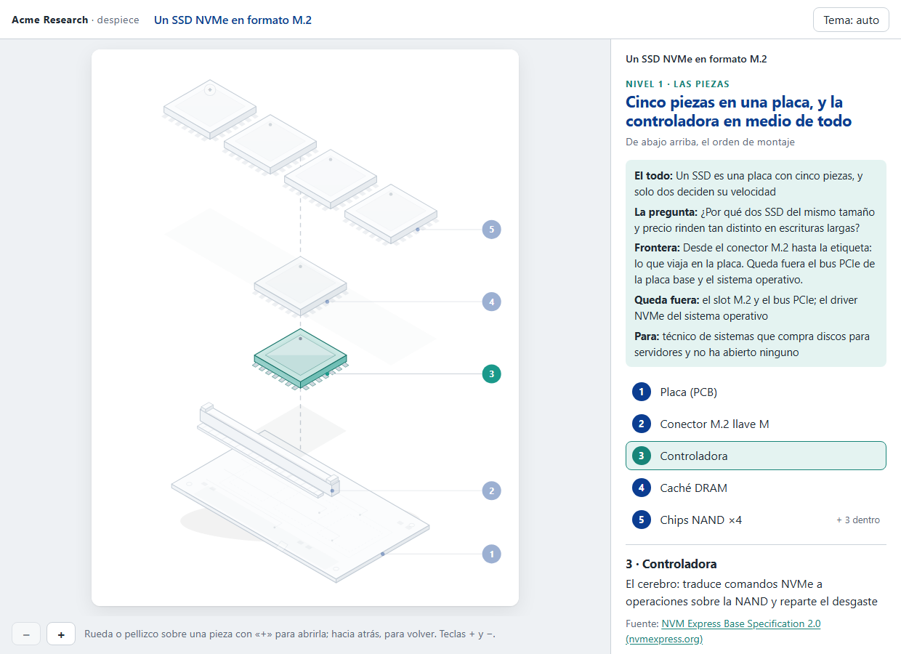
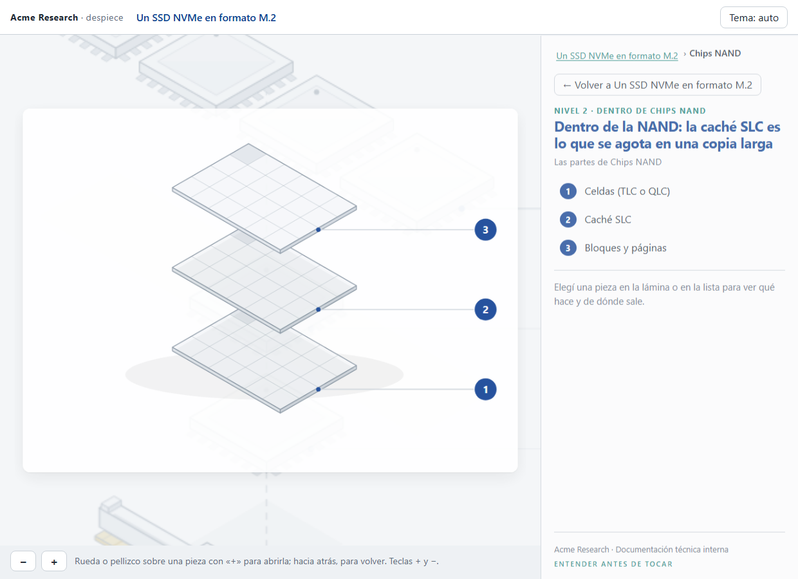
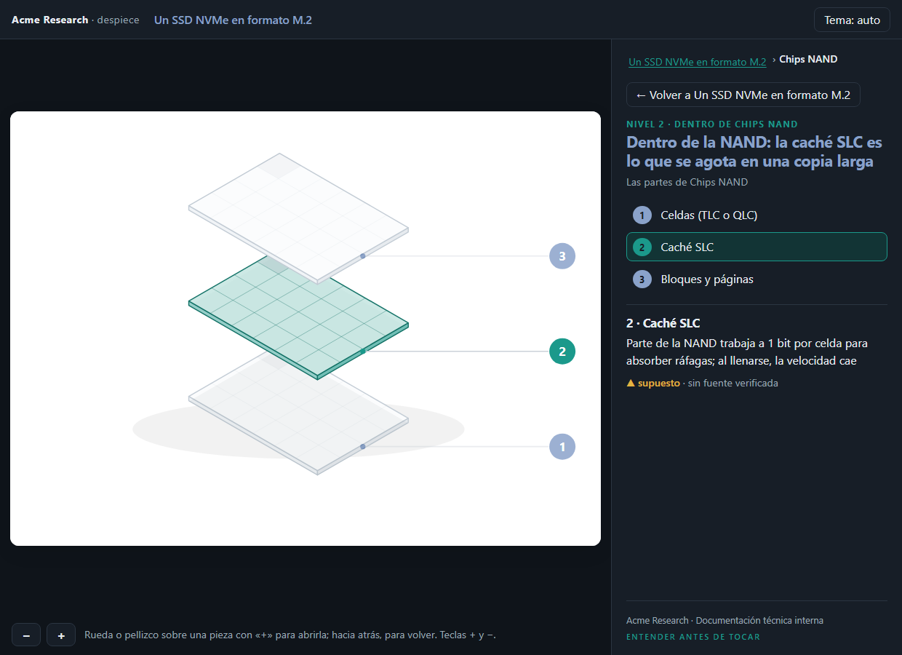
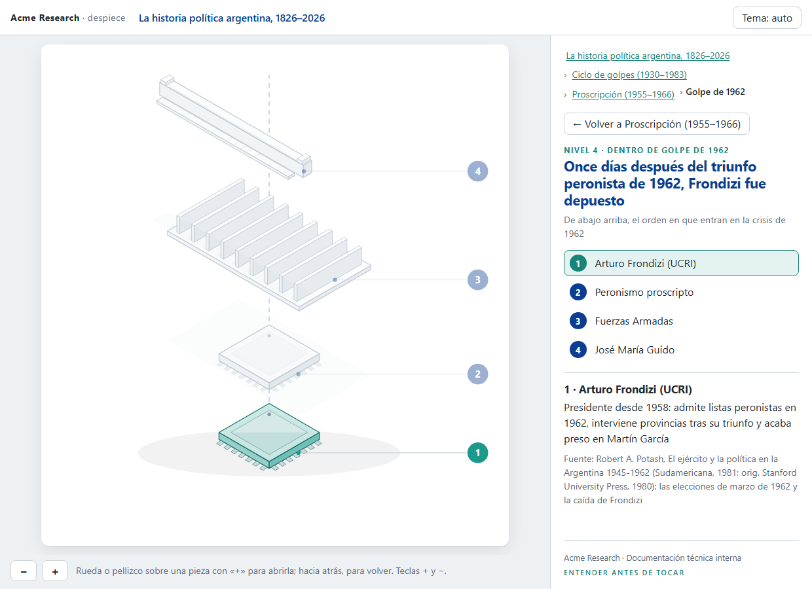
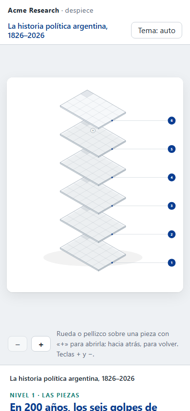
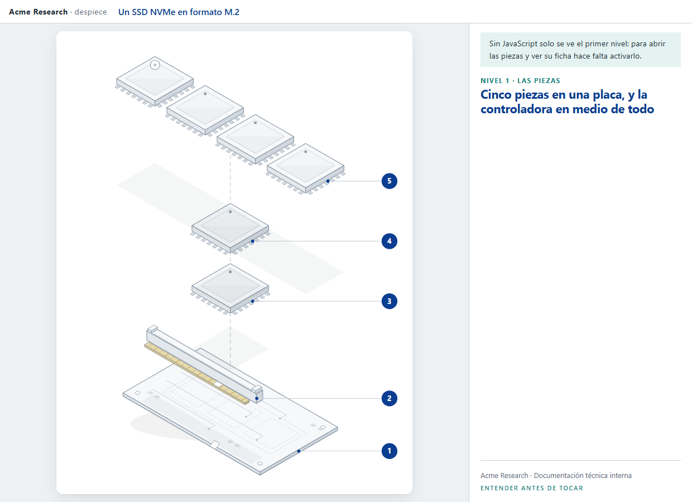

<div align="center">

[**← README**](../README.md) · [**Demo**](demo.md) · [**Interactiva**](interactivo.md) · **Explorador** · [**Instalación**](instalacion.md) · [**Changelog**](../CHANGELOG.md) · [**Licencia**](../LICENSE)

</div>

# El despiece que se recorre con zoom

Desde la 2.1.0, cualquier `modelo.json` (un aparato, una red, una historia, una auditoría) puede salir como un
explorador: una lámina explotada por nivel y **zoom semántico** entre ellas. Te acercás a una pieza con «+» y se
abre en su propia lámina; te alejás y volvés al nivel de arriba. Un panel al costado lleva la ruta, las piezas del
nivel y la ficha de la que elegís, con su función y su fuente. Es un solo fichero HTML, sin librerías ni red.

| Fichero | En esta demo |
|---|---|
| Los modelos | [`assets/ejemplo-fisico.json`](../assets/ejemplo-fisico.json) y [`assets/ejemplo-historia-argentina.json`](../assets/ejemplo-historia-argentina.json) |
| Los exploradores | [`explorador/ssd.html`](explorador/ssd.html) y [`explorador/historia-argentina.html`](explorador/historia-argentina.html) · abrilos en el navegador: [el SSD](https://despiece.t28.io/explorador/ssd.html) y [la historia](https://despiece.t28.io/explorador/historia-argentina.html) |
| Las capturas | [`explorador/capturas/`](explorador/capturas/) |

No necesita bloque `geometria`: las láminas son las mismas de la [página estática](demo.md), dibujadas por la
skill al generar el explorador.

## Cómo se mueve

| Gesto | Qué hace |
|---|---|
| Rueda, pellizco del trackpad o pellizco táctil **sobre una pieza con «+»** | La abre |
| Lo mismo hacia atrás | Vuelve al nivel de arriba |
| Botones «+» y «−», teclas `+` y `-` | Lo mismo, desde el teclado o sin gestos |
| Clic en la lámina o en la lista | Elige la pieza y muestra su ficha; doble clic la abre |
| «Atrás» del navegador | Sube un nivel; «adelante» vuelve a bajar |

Cada nivel tiene su dirección ([`ssd.html#/nand`](https://despiece.t28.io/explorador/ssd.html#/nand)), así que se puede compartir un
enlace que abre directamente dentro de una pieza.

## El SSD: dos niveles

El todo, con la controladora elegida y el contexto del despiece: la pregunta, la frontera y para quién es.

<p align="center">
  
</p>

A mitad del zoom hacia la NAND: el nivel de arriba crece y se desvanece desde la pieza que se abre, y el de
dentro llega.

<p align="center">
  
</p>

Dentro de la NAND, en tema oscuro, con la caché SLC elegida. La ficha la marca como supuesto porque el modelo no
le da fuente.

<p align="center">
  
</p>

## La historia argentina: cuatro niveles

Del todo a un hecho: la historia política, el ciclo de golpes, la proscripción y el golpe de 1962. Las migas
llevan a cualquier nivel de la ruta, y la ficha, la fuente de cada dato.

<p align="center">
  
</p>

## En el móvil y sin JavaScript

En el móvil la lámina va arriba y el panel debajo; el pellizco con dos dedos abre y cierra, y con uno se
desplaza la página. Sin JavaScript se ve el primer nivel con un aviso.

<p align="center">
  
  &nbsp;&nbsp;
  
</p>

## Reproducilo en tu máquina

Python 3.10 o superior para generarlo; Node 22 o superior, y Edge o Chrome, solo para capturarlo.

```bash
cd ~/.claude/skills/despiece
python -I scripts/validar_modelo.py assets/ejemplo-historia-argentina.json
python -I scripts/ensamblar.py assets/ejemplo-historia-argentina.json --salida demo/explorador.html --explorador --marca assets/marca-ejemplo.json
node scripts/capturar-cdp.mjs demo/golpe-1962.png 1240 900 "file://$PWD/demo/explorador.html#/golpe-1962"
```

En Windows, la URL es `file:///C:/Users/<usuario>/.claude/skills/despiece/demo/explorador.html#/golpe-1962`.
Qué capturar y qué mirar, en [`references/explorador.md`](../references/explorador.md#capturar-y-revisar).

Con Claude Code se pide así:

```
/despiece la historia política argentina, en un explorador con zoom: quiero poder entrar en cada período
```

## Por qué las láminas se calculan antes

El explorador no dibuja nada en el navegador: cada lámina sale de `explosionado.py` al generarlo. Así hay un
solo código de dibujo, el explorador enseña exactamente las mismas figuras que la página estática y una
corrección llega a las dos. El navegador solo cambia de lámina y anima el paso.

---

<div align="center">

Un desarrollo de [**Think28**](https://t28.io) · hecho con Claude Code y amor

</div>
