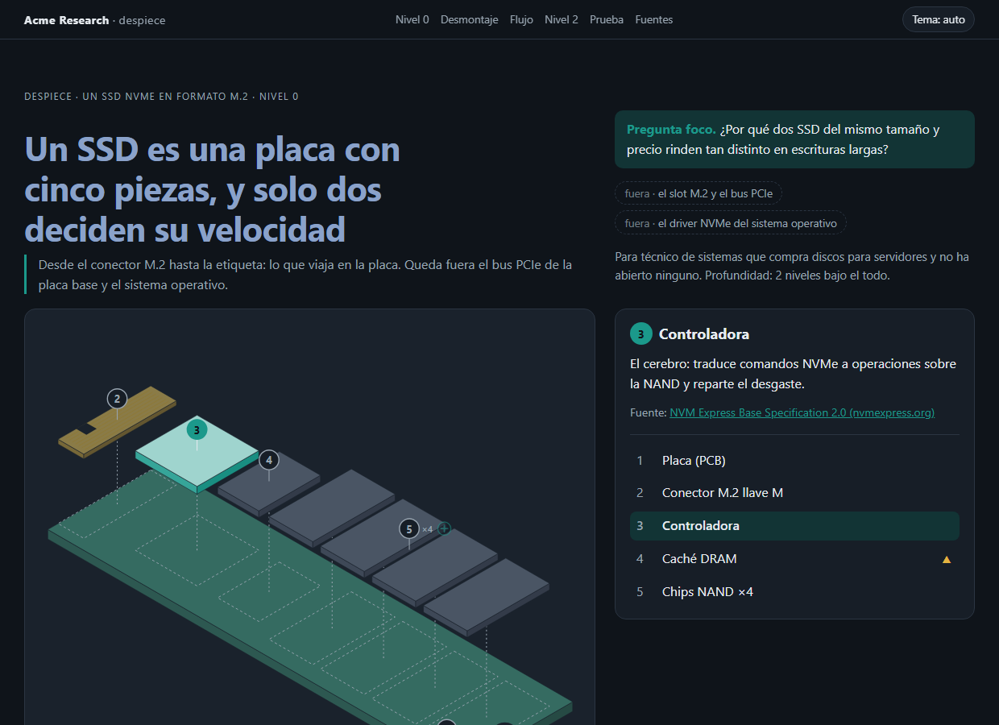
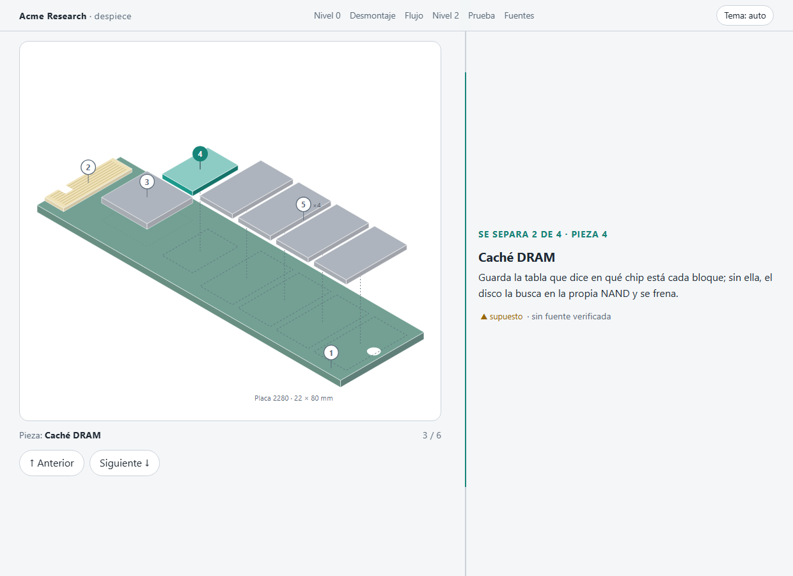
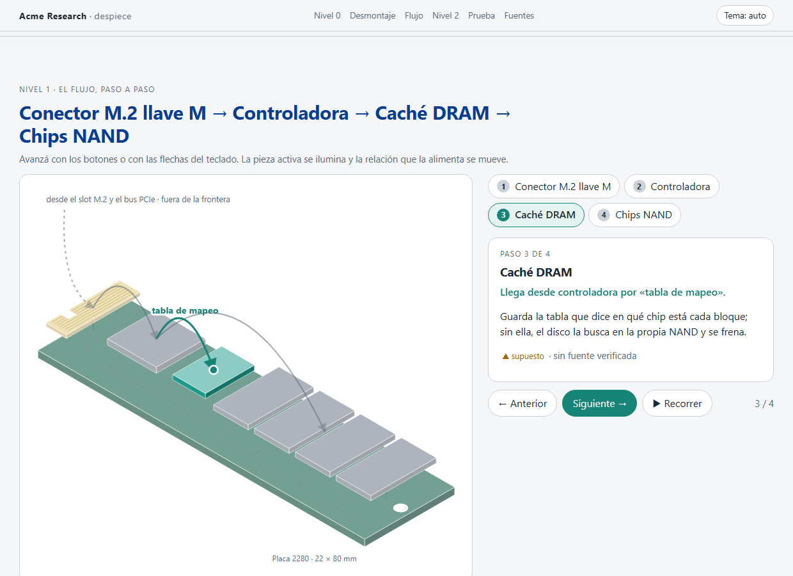
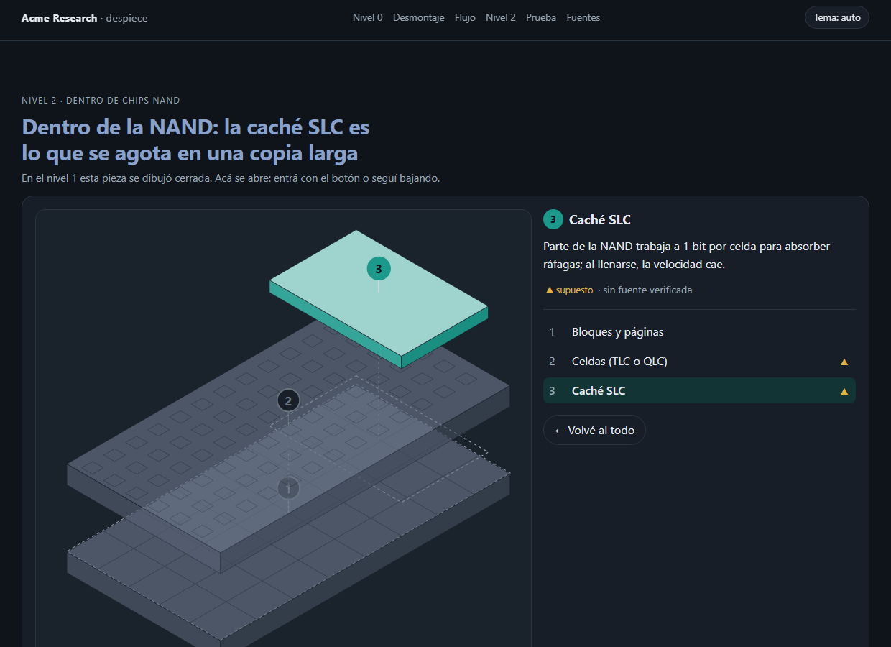
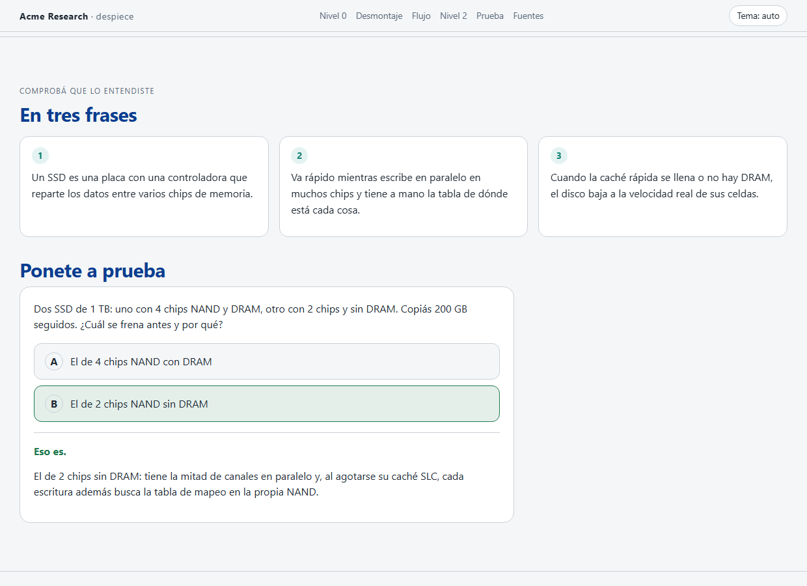
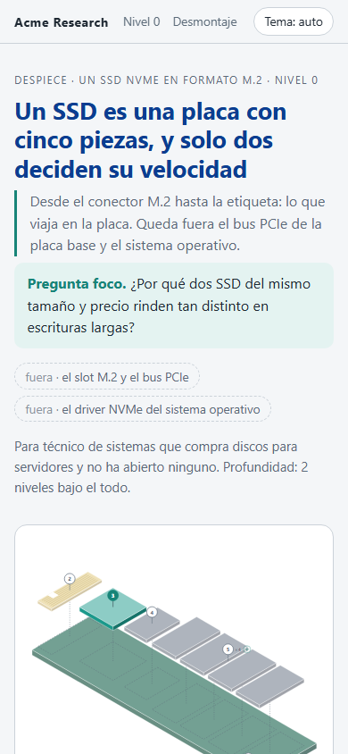
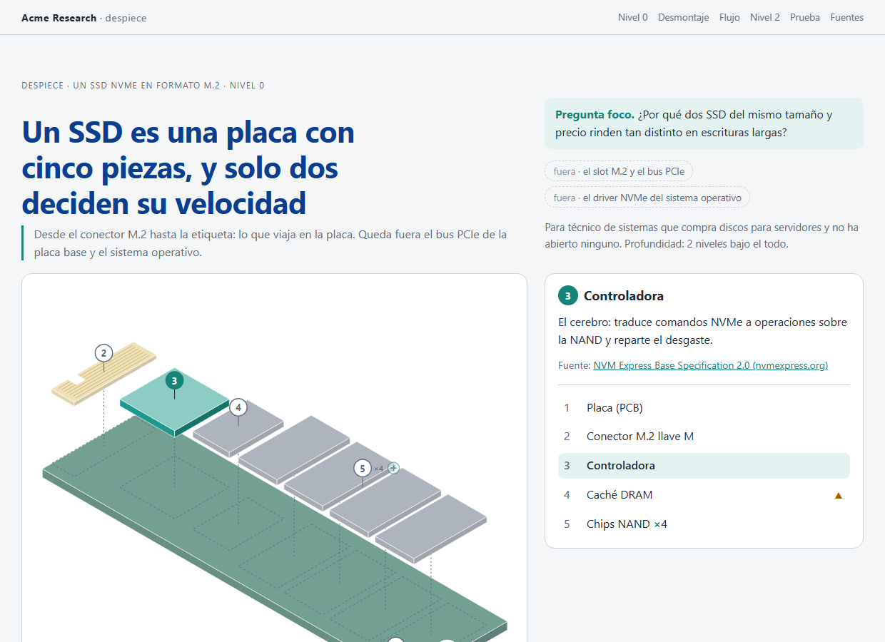

<div align="center">

[**← README**](../README.md) · [**Demo**](demo.md) · **Interactiva** · [**Explorador**](explorador.md) · [**Instalación**](instalacion.md) · [**Changelog**](../CHANGELOG.md) · [**Licencia**](../LICENSE)

</div>

# El despiece que se abre

Desde la 1.2.0, el mismo `modelo.json` puede salir como una página que se arma y se desarma: una vista isométrica
que se abre al cargar, se desmonta pieza a pieza al bajar, recorre el flujo paso a paso y deja entrar en la pieza
que decide. Es un solo `index.html`, sin librerías ni red, que funciona sin JavaScript, en tema claro y oscuro, con
movimiento reducido y en el móvil.

| Fichero | En esta demo |
|---|---|
| El modelo, con su bloque `geometria` | [`assets/ejemplo-fisico.json`](../assets/ejemplo-fisico.json) |
| La página | [`interactivo/index.html`](interactivo/index.html) (descargala y abrila) |
| Las capturas | [`interactivo/capturas/`](interactivo/capturas/) |

Solo para el tipo físico, y opcional: sin `--interactivo`, o sin `geometria` en el modelo, la skill escribe la
[página estática](demo.md) de siempre.

## El caso: el mismo SSD NVMe

Pregunta foco: *¿por qué dos SSD del mismo tamaño y precio rinden tan distinto en escrituras largas?* Mismo lector y
mismos dos niveles que en la [demo estática](demo.md), con la marca de ejemplo (Acme Research).

### Nivel 0: se abre sola

Al cargar, las piezas suben escalonadas desde la placa. El deslizador la arma y la desarma; tocar una pieza, en la
figura o en la lista, la destaca y rellena su ficha con la función y la fuente. Las alturas no se escriben en el
modelo: la skill las calcula para que ninguna pieza tape a otra ni a su número.

<p align="center">
  
</p>

<p align="center">
  
</p>

### Desmontaje: el montaje al revés

Al bajar, la figura queda fija y cada paso levanta una pieza, en orden inverso al de montaje. También se avanza con
los botones, sin scroll.

<p align="center">
  
</p>

### Flujo: por dónde pasa una escritura

Un paso por pieza, con la flecha de la relación que la alimenta y un paquete que la recorre. La entrada desde fuera
de la frontera va punteada. Se avanza con los botones, con las flechas del teclado o con «▶ Recorrer».

<p align="center">
  
</p>

### Nivel 2: dentro de la NAND

La tarjeta se abre al llegar con el scroll, o con «Ver por dentro →» desde la ficha. Las capas apiladas se ven en
rayos X, y la que responde a la pregunta, destacada.

<p align="center">
  
</p>

### El cierre

Las tres frases y la predicción, que ahora pide elegir antes de enseñar la respuesta.

<p align="center">
  
</p>

### En el móvil y sin JavaScript

<p align="center">
  
  &nbsp;&nbsp;
  
</p>

## Reproducilo en tu máquina

Python 3.10 o superior para generarla; Node 22 o superior, y Edge o Chrome, solo para capturarla.

```bash
cd ~/.claude/skills/despiece
python -I scripts/validar_modelo.py assets/ejemplo-fisico.json
python -I scripts/ensamblar.py assets/ejemplo-fisico.json --salida demo/interactivo.html --interactivo --marca assets/marca-ejemplo.json
node scripts/capturar-cdp.mjs demo/portada.png 1240 900 "file://$PWD/demo/interactivo.html?p=1"
```

En Windows, la URL es `file:///C:/Users/<usuario>/.claude/skills/despiece/demo/interactivo.html?p=1`. Qué
capturar y qué mirar en cada captura, en [`references/interactivo.md`](../references/interactivo.md#capturar-y-revisar).

Con Claude Code se pide así:

```
/despiece un SSD NVMe, en una página que se pueda abrir y recorrer: quiero entender qué pieza decide la velocidad en escrituras largas
```

## Cómo se llegó aquí

- [El prototipo](prototipo-interactivo/index.html) que sirvió para decidir, escrito a mano para este SSD.
- [El research](research-interactivo.md): referentes, evidencia sobre animación y aprendizaje, soporte de
  navegador, decisiones tomadas y qué cambió al implementarlo.

---

<div align="center">

Un desarrollo de [**Think28**](https://t28.io) · hecho con Claude Code y amor

</div>
